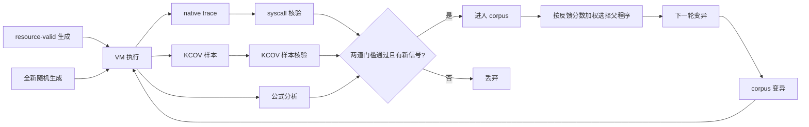

当前基线：Linux 6.12.1

## 当前插桩位置

### 1. Counter 更新路径

checker 维护 ext4 元数据计数的独立 shadow state，并在真实计数更新的附近记录事件。当前主要插桩位置如下：

| 文件                  | 关注路径                                     | 检查内容                                   |
| --------------------- | -------------------------------------------- | ------------------------------------------ |
| `fs/ext4/mballoc.c` | cluster 分配、释放、metadata block 分配/释放 | 全局和 block group 的 free cluster 变化    |
| `fs/ext4/ialloc.c`  | inode 分配、释放、目录 inode 创建/删除       | free inode、目录数及 inode bitmap 相关变化 |
| `fs/ext4/resize.c`  | online resize 的 group/global counter 更新   | 新增 block group 后的计数一致性            |

## Checker 规则

Global/group 聚合一致性

最基本的全局规则是：

```text
global_free_clusters == sum(group_free_clusters)
global_free_inodes   == sum(group_free_inodes)
```

Bitmap、descriptor、checksum 和 bounds

对于 block group，checker 还需要把计数与实际 bitmap/descriptor 状态交叉比较：

```text
group free clusters == block bitmap 中的空闲数量
group free inodes   == inode bitmap 中的空闲数量
```

同时检查 descriptor 的范围、checksum 及相关元数据边界。报告中的常见分类包括：

```text
bitmap
descriptor
checksum
global
```

syscall

目前是利用syzkaller 生成的是一段有依赖关系的 syscall 程序
提前给定检查用到的操作

问题
checker 观察到的中间状态，造成很多误报

快照告诉 checker这次扫描读到的值可能不属于同一个时间点，因此不能直接拿它们比较并报告漏洞。后面安静状态检查变化是否一致

## 一、本周任务

1. **对全部目标公式建立插桩**
2. **长时间运行，观察每个插桩点的状态** 统计每个点经过多少次、其中多少次一致或不一致。
   单负载执行的 **12 小时实验**。第一条链检查位图、组描述符和全局计数的关系，第二条链检查目录引用与 inode 链接数的关系。

| 操作序列执行次数        | 4,565   |
| ----------------------- | ------- |
| 生成系统调用数          | 145,346 |
| 操作出口异常 / 持续异常 | 0 / 0   |

### 1. 空闲簇变化与块位图转换

检查实际块位图分配、释放的簇数，是否与组描述符和全局空闲簇计数的变化一致。

| 插桩点                 | 命中   | 组描述符：一致 / 不一致 | 全局：一致 / 不一致 | 公式   | 后续恢复阶段                                             |
| ---------------------- | ------ | ----------------------- | ------------------- | ------ | -------------------------------------------------------- |
| 块位图实际转换         | 60,716 | 0 / 60,716              | 0 / 60,716          | 不一致 | 组描述符在本地更新完成时恢复；全局在分配或释放发布时恢复 |
| 块组描述符本地更新完成 | 60,716 | 60,716 / 0              | 0 / 60,716          | 不一致 | 全局继续等待发布                                         |
| 块全局计数更新         | 60,716 | 60,716 / 0              | 60,716  / 0         | 一致   | 全局差值在这里恢复，共 60,716 次                         |

观察到的顺序是：位图先改变，描述符随后更新，全局计数最后更新。因此，位图点每次都暂时不一致，描述符更新点每次都恢复描述符一致性，全局计数点每次都恢复全局一致性。

### 2. 空闲 inode 变化与 inode 位图转换

检查 inode 位图实际分配、释放，是否与组描述符和全局空闲 inode 计数的变化一致。

| 插桩点                 | 命中   | 组描述符：一致 / 不一致 | 全局：一致 / 不一致 | 公式   | 后续恢复阶段                                           |
| ---------------------- | ------ | ----------------------- | ------------------- | ------ | ------------------------------------------------------ |
| inode 分配位图转换     | 55,305 | 0 / 55,305              | 0 / 55,305          | 不一致 | 描述符在分配描述符更新时恢复；全局在分配全局发布时恢复 |
| inode 分配组描述符更新 | 55,305 | 55,305 / 0              | 0 / 55,305          | 不一致 | 全局在后续分配发布时恢复，共 55,305 次                 |
| inode 分配全局计数更新 | 55,305 | 55,305 / 0              | 55,305 / 0          | 一致   | 分配计数全部恢复                                       |

分配位图转换后，独立空闲量先减少 1，而描述符和全局计数尚未减少，差值为 +1；释放位图转换后，独立空闲量先增加 1，差值为 −1。后续两级发布依次恢复。

### 3. 目录 inode 计数变化

检查目录 inode 的实际创建、释放，是否与组描述符和全局目录计数一致。这里统计目录 inode 数，不是目录里的条目数。

| 插桩点                      | 命中   | 组描述符：一致 / 不一致 | 全局：一致 / 不一致 | 后续恢复阶段                                           |
| --------------------------- | ------ | ----------------------- | ------------------- | ------------------------------------------------------ |
| 目录 inode 分配             | 27,708 | 0 / 27,708              | 0 / 27,708          | 描述符在分配描述符更新时恢复；全局在分配全局发布时恢复 |
| 目录 inode 分配组描述符更新 | 27,708 | 27,708 / 0              | 0 / 27,708          | 全局在后续分配发布时恢复，共 27,708 次                 |
| 目录 inode 分配全局计数更新 | 27,708 | 27,708 / 0              | 27,708 / 0          | 创建目录计数全部恢复                                   |

创建生命周期先增加期望目录数，描述符和全局尚未增加，差值为 −1；释放生命周期先减少期望目录数，差值为 +1。每类不一致均 27,708 次全部恢复。

### 4. 稳定快照公式：块、inode、目录计数的交叉检查

这些公式均在“稳定内存快照”点检查，按组、汇总或 inode 采用不同计数单位。

| 插桩点与检查内容                | 命中   | 一致   | 不一致 | 是否需要后续恢复 |
| ------------------------------- | ------ | ------ | ------ | ---------------- |
| 组空闲簇计数与逻辑块位图        | 45,655 | 45,655 | 0      | 没有观察到差值   |
| 全局空闲簇与组描述符汇总        | 27,393 | 27,393 | 0      | 没有观察到差值   |
| 组空闲 inode 与逻辑 inode 位图  | 45,655 | 45,655 | 0      | 没有观察到差值   |
| 全局空闲 inode 与组描述符汇总   | 27,393 | 27,393 | 0      | 没有观察到差值   |
| 组目录计数与独立 inode 类型扫描 | 45,655 | 45,655 | 0      | 没有观察到差值   |
| 全局目录计数与组描述符汇总      | 27,393 | 27,393 | 0      | 没有观察到差值   |
| 全局目录计数与独立扫描汇总      | 27,393 | 27,393 | 0      | 没有观察到差值   |

## 状态是否一直不变

**比较状态并不是整个运行过程一直不变。** 数据显示，很多操作反复经历“出现差值—后续恢复”的变化。观察到的规律是同类点的结果较稳定：

| 路径                 | 中间状态                         | 恢复阶段                     | 操作出口 / 稳定状态 |
| -------------------- | -------------------------------- | ---------------------------- | ------------------- |
| 块分配与释放         | 位图转换后描述符、全局暂时不一致 | 描述符更新，再到全局更新     | 未发现残留差值      |
| inode 分配与释放     | 位图转换后差值为 +1 或 −1       | 描述符更新，再到全局更新     | 未发现残留差值      |
| 目录 inode分配与释放 | 位图转换先于计数更新             | 目录描述符更新，再到全局更新 | 未发现残留差值      |

例如，inode 分配位图点的 55,305 次比较全部暂时不一致，而分配全局计数更新点的 55,305 次全部一致。

## 总体结果

在已建模、已命中的路径范围内，未发现确认的 ext4 计数错误：中间差值全部恢复，操作出口和稳定状态无残留，最终磁盘证据一致。

## 发现的问题

### 1. 覆盖反馈

目前 只有 **7.03%** 的生成调用触发公式转换事件

### 2. 长跑吞吐持续下降

| 指标           | 第 1 小时 | 第 12 小时 |
| -------------- | --------- | ---------- |
| 执行段数       | 642       | 226        |
| 生成系统调用数 | 20,448    | 7,182      |
| 每段耗时中位数 | 5.564 秒  | 14.564 秒  |

## 下一步工作

| 顺序 | 工作         | 目的与验收标准                             |
| ---- | ------------ | ------------------------------------------ |
| 1    | 增加公式     | 提高公式数量扩大范围                       |
| 2    | 改进反馈调度 | 结合插桩点和 ext4 路径反馈，提高覆盖收益   |
| 3    | 扩展场景     | 增加长期存活资源、大目录、自然资源接近耗尽 |

## 2026-10-14 ~ 2026-10-20

### 1. 反馈调度改进

本轮把资源有效输入策略与 KCOV 覆盖、native trace 核验和公式事件纳入同一个反馈闭环。调度器定期加入 resource-valid/stateful 候选程序，提高引用真实文件、目录和 fd 的操作比例；其他轮次继续使用普通生成、corpus 变异和无效参数探索。

#### 调度闭环

| 阶段          | 规则                                                                                                | 作用                                   |
| ------------- | --------------------------------------------------------------------------------------------------- | -------------------------------------- |
| 候选输入      | 按固定周期使用 resource-valid/stateful 输入；其他轮次从 corpus 变异，并定期 fresh generate          | 增加有效资源关系操作，同时保留普通探索 |
| syscall 核验  | 将生成程序的 syscall 数量、顺序和调用坐标与 native trace 对照；缺失、额外或无法对应的调用视为未核验 | 确认反馈确实来自目标程序执行           |
| KCOV 样本核验 | 检查样本格式、版本、长度和 PC 数据，并拒绝缺失、截断、非法、饱和或多余样本                          | 避免不完整覆盖数据污染全局集合         |
| 信号提取      | 统计新增普通 PC、ext4 PC、公式点、稀有公式点、新 mismatch 和未核验签名                              | 同时考虑通用代码覆盖与 ext4 计数路径   |
| corpus 准入   | syscall 全部核验且 KCOV 样本完整后，程序才可更新覆盖集合或进入 corpus                               | 保留执行证据完整、可追溯的程序         |
| 父程序选择    | 按反馈分数确定性加权轮转，同时保留所有已接纳父程序的最低选择机会                                    | 增加高价值程序后续变异机会             |

#### 一轮反馈流程

一轮以一个 syzkaller 程序为单位：程序生成后在 VM 中执行，完成 syscall 与 KCOV 核验、信号提取和评分；满足准入条件的程序进入 corpus，供后续父程序选择和变异。



覆盖分数为：

```text
新增普通 PC + 4 × 新增 ext4 PC
```

公式和生命周期信号的联合分数为：

```text
4 × 新公式点
+ 2 × 稀有公式点（累计命中少于 3 次）
+ 8 × 新 mismatch 签名
+ 3 × 新未核验签名
```

mismatch 和未核验信号只影响后续探索优先级，不代表测试通过或漏洞已确认；操作出口和持续差值仍由生命周期分析、稳定快照及磁盘校验判定。

#### 等量 A/B 效果

普通输入和资源有效候选各执行并核验 640 个 syscall，比较结果如下：

| 指标                          | 普通 syzkaller 输入 | 资源有效候选输入 |
| ----------------------------- | ------------------: | ---------------: |
| 目标 syscall / 已核验 syscall |           640 / 640 |        640 / 640 |
| 返回成功的 syscall 数         |                 194 |              427 |
| 公式转换次数                  |                  23 |              183 |
| 公式转换密度                  |               3.59% |           28.59% |
| `linkat` 成功 / 执行        |               0 / 3 |          20 / 37 |
| `unlinkat` 成功 / 执行      |              0 / 76 |          22 / 40 |
| `rmdir` 成功 / 执行         |              0 / 20 |          40 / 46 |
| `renameat2` 成功 / 执行     |              0 / 39 |          81 / 97 |
| `mkdirat` 成功 / 执行       |              0 / 56 |          21 / 41 |
| `symlinkat` 成功 / 执行     |              0 / 21 |           3 / 17 |

在相同 syscall 预算下，资源有效候选的公式转换密度从 3.59% 提高到 28.59%，link、unlink、rmdir 和 rename 的成功执行也明显增加。这说明调度把更多预算分配给能建立有效资源关系的程序，而不是只增加调用总数。

#### 12 小时长跑反馈结果

| 指标               |          结果 |
| ------------------ | ------------: |
| 完整 KCOV 样本     | 4,619 / 4,619 |
| 全局普通 PC        |        12,378 |
| 全局 ext4 PC       |         4,213 |
| corpus 程序数      |           225 |
| 联合反馈覆盖公式点 |           113 |
| 错误候选           |             0 |
| 反馈耗时 p50       |     约 5 毫秒 |
| 已核验 syscall     |       147,808 |

### 2. 特殊场景

| 场景      | 内容                                                                 | 结果     |
| --------- | -------------------------------------------------------------------- | -------- |
| stateful  | 预建长期存活的 retained 文件，验证跨段资源关系                       | 全部通过 |
| large-dir | 预建大目录（批量 entry），验证目录计数与 dirent 扫描                 | 全部通过 |
| pressure  | fallocate 预分配至接近空间耗尽（目标剩余 24 MB），验证资源压力下计数 | 全部通过 |

### 3. 新增公式

新增五组计数一致性关系，全部插桩并通过定向 VM 验证。12 小时长跑命中与检查结果：

| 数学表达式                                     | 具体解释                                    |    一致 | 不一致 |
| ---------------------------------------------- | ------------------------------------------- | ------: | -----: |
| `free_delta(evict) == 位图新增空闲数`        | inode 释放时，空闲增量为实际位图新增空闲数  | 162,904 |      0 |
| `orphan_slot_delta == 新增孤儿空槽`          | orphan 生命周期中，空槽增量为实际新增空位   |  82,500 |      0 |
| `orphan_free == 孤儿文件区空闲槽总数`        | orphan 文件区空闲槽总数等于实际扫描结果     | 886,944 |      0 |
| `xattr_refcnt == 共享该 xattr 块的 inode 数` | xattr 块引用计数等于实际共享该块的 inode 数 |  27,717 |      0 |
| `xattr_ref_delta == 释放时减少的引用数`      | xattr 释放时减少的引用数与实际一致          |     655 |      0 |

## 最新 12 小时长跑结果

passed=true，无 issues，干净关机，三镜像 fsck 与磁盘哈希全部通过。

| 指标                |          数值 |
| ------------------- | ------------: |
| 完整 segment        |         4,619 |
| 已核验 syscall      |       147,808 |
| 公式转换密度        |         25.5% |
| 操作出口 / 持续差值 |         0 / 0 |
| KCOV 完整样本       | 4,619 / 4,619 |

## 总体结果

此前 12 小时反馈长跑与新增公式、特殊场景实验中的差值均为暂态，操作出口和稳定状态无残留。本周随机注入长跑的结果单列于后文。

## 发现的问题

1. 反馈闭环范围有限。KCOV 联合反馈目前只在 runner 内部生效，未接入 syzkaller manager，也不支持多 VM corpus 合并与 CMP 反馈，corpus 累积到 225 后增长放缓。
2. 极端路径依赖特殊实验。journal 错误出口、inline 数据转换边界、eviction 与 orphan 交互等场景主要靠定向特殊实验触发，普通长跑难以覆盖。
3. 个别插桩点命中极少。XATTR 引用增减、GROUP 位图初始化等 4 个点全程仅命中 2 次，这些公式路径在长跑中的验证强度仍然不足。

## 下一步工作

| 顺序 | 工作                        | 当前状态与验收标准                                                                                                          |
| ---- | --------------------------- | --------------------------------------------------------------------------------------------------------------------------- |
| 1    | 反馈覆盖与调度              | **未完成**。仍需接入 syzkaller manager，支持多 VM corpus 合并和 CMP 反馈；验收为公式转换密度、ext4 PC 和有效 namespace 操作持续提升。 |
| 2    | fault-injection 候选确认     | **部分完成**。随机注入和候选复核已完成，但同 build、同 worker、同 workload 的无注入 control 尚未完成；验收为每个高置信候选都有匹配 control、原始镜像、`e2fsck` 和 raw checker 四项证据。 |
| 3    | 并发交错归因与报告聚合       | **部分完成**。2 worker 融合长跑已完成，但 fault-taint 后的最终镜像归因和完整 campaign 报告仍需补齐；验收为按 segment 保留证据、流式聚合不再造成内存增长，并能生成可复核汇总。 |
| 4    | 公式多样性与低命中路径       | **未完成**。继续覆盖 XATTR 引用、GROUP 位图初始化、orphan/eviction 交互和 inline 边界；验收为低命中公式有定向 workload 和独立稳定快照结果。 |

## 2026-10-21 ~ 2026-10-28 本周工作

本周完成两次长时间 VM 运行：三小时单 worker 随机错误注入，以及十小时双 worker 共享对象并发。前者让指定 ext4 hook 在运行时按概率返回配置的 errno，再观察 workload 是否完成、稳定状态与最终磁盘；后者让两个独立生成的 syscall 序列同步操作共同文件和目录，并验证并发后的静止状态。

### 1. 三小时单 worker 随机错误注入

当 workload 执行经过所选 hook 时，按照概率命中；每个最多注入一次。命中时从该 hook 的 errno 白名单选择返回值：

| hook                                                 | 可选 errno                                                                              |
| ---------------------------------------------------- | --------------------------------------------------------------------------------------- |
| `mballoc_mark`（块位图分配或释放前）               | `EIO`、`ENOMEM`、`EINVAL`、`ENOSPC`、`EROFS`、`EFSCORRUPTED`、`EFSBADCRC` |
| `unlink_inode_dirty`（unlink 修改 inode 后）       | `EIO`、`ENOMEM`、`EINVAL`、`ENOSPC`、`EROFS`、`EFSCORRUPTED`                |
| `inode_evict_final_dirty`（删除 inode 最终写回前） | `EIO`、`ENOMEM`、`EINVAL`、`ENOSPC`、`EROFS`、`EFSCORRUPTED`                |

注入只让目标 ext4 操作返回错误；真实命中 20 次：

| hook                        | 命中次数 |
| --------------------------- | -------: |
| `mballoc_mark`            |       11 |
| `unlink_inode_dirty`      |        3 |
| `inode_evict_final_dirty` |        6 |

| errno            | 次数 |
| ---------------- | ---: |
| `EIO`          |    2 |
| `ENOMEM`       |    2 |
| `EINVAL`       |    2 |
| `ENOSPC`       |    4 |
| `EROFS`        |    3 |
| `EFSCORRUPTED` |    4 |
| `EFSBADCRC`    |    3 |

稳定状态和磁盘检查曾给出 42 条待复核快照候选，分布在 22 个 syscall 序列；这些告警没有逐项证明独立漏洞，已从漏洞清单中移除。原始 `campaign-lhze43mu` 作为本周长跑记录保留，其中的 regular、bigalloc、inline 快照告警不作为已确认漏洞。上表记录该次运行时的 hook 策略；清理后新工程的随机池为 `mballoc_mark` 和 `inode_evict_final_dirty`。

### 2. 十小时双 worker 共享对象并发

全部 syscall序列运行后结果为 complete，均无 issue；生命周期报告也全部完整。并发与状态结果如下：

| 检查项                      |                                 结果 |
| --------------------------- | -----------------------------------: |
| syscall 配对核验            |                      71,296 / 71,296 |
| transient mismatch          |                              365,532 |
| concurrent / ambiguous      |                                3,025 |
| persistent mismatch         |                                0 / 0 |
|  checker 与 `e2fsck -fn` | 均有效；均退出 0，并匹配最终稳定快照 |

暂态 mismatch 数量很大，但最终操作出口和持续差值分类均为 0，所有有效静止快照通过。

### 3. 本周结论

双 worker 同步共享对象的长跑路径已经运行十小时；单线程随机错误注入也已在长跑中实际进行错误注入出现候选。

### 4. 首次异常到离线证据的因果链审计

本轮新增离线审计器，把首次退化 segment、fault hook、native syscall envelope、hook 关联 inode、最终稳定快照、离线磁盘/e2fsck 结果和无注入运行放在同一条证据链中。审计器只读原始 campaign，不改写历史 trace 或快照。报告见 [`audit.md`](experiments/ext4-counter-trace/results/campaign-lhze43mu-causality/audit.md)，结构化结果见 [`audit.json`](experiments/ext4-counter-trace/results/campaign-lhze43mu-causality/audit.json)。

| 文件系统镜像 | 首次异常                                            | hook / errno                              | syscall 归属                               | hook inode 与离线 inode 交集 | 当前结论                             |
| ------------ | --------------------------------------------------- | ----------------------------------------- | ------------------------------------------ | ---------------------------- | ------------------------------------ |
| regular      | 未观察到                                            | 无                                        | 无                                         | 无                           | 干净                                 |
| bigalloc     | segment 139；`namespace_valid` 从 true 变为 false | `inode_evict_final_dirty` / `-EINVAL` | `rmdir` call 6；native envelope 核验通过 | inode 38                     | hook 与 inode 链接成立，但只能算候选 |
| inline       | segment 53；`namespace_valid` 从 true 变为 false  | `inode_evict_final_dirty` / `-EROFS`  | 没有 enclosing `CT_SYSCALL` envelope     | inode 30                     | 部分链路成立，syscall 归属未证实     |

bigalloc 的最终 `e2fsck` 报告涉及 inode 31、35、38，inline 的最终磁盘 checker 和 `e2fsck` 涉及 inode 30、35、39。共同 inode 只能证明 hook 对象与离线异常存在交集；不能解释同一结果中的其他 inode，也不能单独证明内核漏洞。

现有无注入运行 [`campaign-k3gxmeex`](experiments/ext4-counter-trace/results/campaign-k3gxmeex) 干净结束，但它使用 `concurrent/2 workers`，故障运行使用 `single/1 worker`，且 kernel、probe patch、manifest 绑定哈希不同。审计器将它标记为 `control_observed_but_not_matched`，不会把它当成严格对照。后来创建的同配置无注入尝试 `campaign-gdpal9d8` 在源码和 build preflight 阶段失败，没有产生有效文件系统对照；该失败目录已清理。

因此本轮没有升级为“具体内核漏洞”：bigalloc 目前是强 hook/syscall/inode/离线交集候选，inline 仍缺 syscall 归属，两个镜像都缺同配置且同 build 的无注入对照。审计摘要中的 `causal_candidates` 为 0；完成同 build 的无注入 control 并补齐 inline 的 syscall 边界后才能重新评估。

### 5. 前期计划完成情况

| 原计划 | 当前状态与结果 |
| ------ | -------------- |
| 增加错误注入点 | **已完成本轮扩展**：融合 campaign 覆盖多类 hook，记录 764 次随机注入命中；未命中或缺少事件归因的记录仍需单独标为未验证。 |
| 分析候选是否真实并完善 checker | **候选复核已完成，checker 改进未完成**：42 条稳定快照候选已确认为读取失败和重复快照导致的误报；候选准入和去重规则列入本周后续工作。 |
| 将并发与错误注入融合运行 | **已完成运行**：2 worker 融合长跑完成 940 个 segment；最终 regular 镜像仍有 fault-tainted 离线异常，因果归属尚未完成。 |

## 2026-10-28 ~ 2026-11-4 本周工作

本周完成两项工作：复核三小时单 worker 随机错误注入产生的候选，并完成并发与随机错误注入融合的十小时长跑。候选复核只判断现有数据能否证明真实持久化问题；注入本身造成的错误状态不直接升级为无故障内核漏洞。

### 1. 三小时单 worker 随机错误注入候选复核

复核对象为 [`campaign-lhze43mu`](experiments/ext4-counter-trace/results/campaign-lhze43mu)，运行 10,800 秒、单 worker、三个文件系统镜像。随机池为 `mballoc_mark`、`unlink_inode_dirty` 和 `inode_evict_final_dirty`，每个 segment 最多注入一次。日志记录 40 次故障状态事件，其中 20 次是三个目标 hook 的随机命中（`mballoc_mark` 11 次、`unlink_inode_dirty` 3 次、`inode_evict_final_dirty` 6 次）；其中 segment 53 的命中虽有 fault-status 证据，但事件归因在汇总报告中标为 `unresolved`，不能计入已验证 hook。其余 20 次是 fault reset 后的 `off` 状态记录，不作为新的 hook 命中证据。

报告共生成 44 条候选记录：42 条稳定快照候选，分布在 22 个 segment；另有 bigalloc 和 inline 各 1 条离线磁盘候选。它们不是 44 个独立问题，复核结果如下：

| 候选数据          | 是否能证明真实漏洞    | 复核结果                                                                                                                                                                                                                 |
| ----------------- | --------------------- | ------------------------------------------------------------------------------------------------------------------------------------------------------------------------------------------------------------------------ |
| 42 条稳定快照候选 | 否，属于 checker 误报 | 所有记录 `observed_mismatches=0`、`relations_valid=true`；只有 `namespace_valid=false`，原因是注入错误后 inode 读取失败（`inode_read_failed`）。同一受污染文件系统的 before/after 快照被重复计数，形成多条候选。 |

因此，42 条稳定快照候选中没有可以升级为“已确认漏洞”的结果。误报来自两处候选处理问题：注入错误后 inode 读取失败，checker 将 `namespace_valid=false` 的“不可验证”状态当作候选；同一 fault episode 的 before/after 快照又被重复计数。bigalloc 和 inline 的两条离线异常另列为未确认候选，不能据此归因于某个 hook。

### 2. 并发与错误注入融合运行

复核和筛选后，完成 [`campaign-fmxs5w3e`](experiments/ext4-counter-trace/results/campaign-fmxs5w3e) 十小时、2 worker、共享文件系统对象的随机错误注入长跑。

#### 结果

| 指标                |            结果 |
| ------------------- | --------------: |
| syscall             | 60,160 / 60,160 |
| native 成功返回     |          33,605 |
| 数据 syscall / 成功 |  11,017 / 8,742 |

`transient_mismatch` 52,401 次，`persistent_mismatch` 0 次。并发下大量差值都发生在写入顺序或快照不健康期间。

| 最终文件系统 | disk checker | `e2fsck -fn`                                | 与最终稳定快照 |
| ------------ | ------------ | --------------------------------------------- | -------------- |
| regular      | 失败         | exit 0，但报告 free block/free inode 计数错误 | 不一致         |
| bigalloc     | 通过         | exit 0                                        | 一致           |
| inline       | 通过         | exit 0                                        | 一致           |

regular 的最终镜像确实存在离线计数异常，bigalloc、inline 的最终磁盘证据通过。

### 3. 本周结论

三小时单 worker 注入的稳定快照候选已完成复核：42 条是 inode 读取失败和重复快照造成的误报；bigalloc 和 inline 各有一条离线异常候选，因缺少严格 control 或 syscall 归因而未确认。并发与错误注入已完成十小时融合运行：分析器没有记录 persistent mismatch episode，但 regular 最终镜像存在离线计数异常且被标为 fault-tainted，因此仍不能把它归因到具体 hook 或 syscall。

### 4. 下一步工作

| 顺序 | 工作 | 当前状态与下一步验收 |
| ---- | ---- | -------------------- |
| 1 | 修正候选准入与去重 | **立即处理**：`namespace_valid=false`、缺少完整 hook/syscall envelope、或快照处于 `concurrent_or_unhealthy` 时标为 `unverified`，不计作 mismatch；同一 fault episode 的 before/after 只保留一条根因记录。用 `campaign-lhze43mu` 重算，42 条快照误报应消失，证据不足项仍可追踪。 |
| 2 | 固化 inode eviction 新后置条件 | [`inode_evict_group_desc_access + EROFS` 复核记录](experiments/ext4-counter-trace/results/campaign-fmxs5w3e/CANDIDATE-REPRO-ANALYSIS.md)中已有两次独立复现，raw checker 与 `e2fsck -fn` 均显示 bitmap 已清除但 group descriptor free-inode 计数未更新。修正 `fault_plan.py` 对 `source_defined` caller contract 和 EROFS handle-abort 语义的校验，再用原始证据重跑 validator；将 `R-IDELTA-EVICT` 与既有 bitmap 未释放的 `R-IEVICT` 分开记录。 |
| 3 | 补齐三小时候选的因果对照 | **未完成**：为 `campaign-lhze43mu` 的 single/1 worker 故障配置补跑同 kernel、probe、manifest、seed、workload 的无注入 control；补齐 inline segment 53 的 syscall envelope。bigalloc/inline 候选需有匹配对照、原始镜像、`e2fsck -fn` 和 raw checker 证据后再定性。 |
| 4 | 完成融合长跑的归因与报告 | **部分完成**：regular 最终镜像保持 `fault-tainted`、不归因；核对 9 条未验证 errno/事件和 2 条 hook-only 记录，能关联时补齐 hook、worker、syscall，否则明确保留为未归因。对 `segment-summary.jsonl` 做流式聚合并生成完整 campaign report。 |
| 5 | 合并已知类别并避免重复计数 | rmdir/unlink/rename 的 `R-LINK`、inode bitmap 泄漏和 orphan slot 候选与既有 finding 合并，不按本轮命中数新增漏洞；本轮新确认的 free-inode descriptor 后置条件单独跟踪。 |
| 6 | 推进旧的覆盖与低命中路径任务 | **仍未完成**：继续推进 syzkaller manager、多 VM corpus 合并和 CMP 反馈；为 XATTR、GROUP、orphan/eviction、inline 转换及自然资源耗尽补定向 workload，并记录命中率和稳定/离线检查结果。 |
