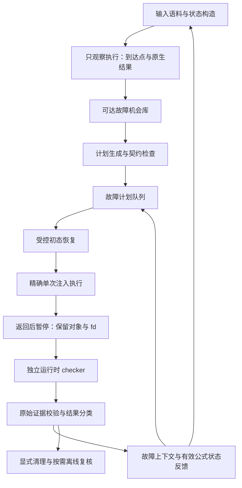

# 面向 ext4 运行时元数据一致性检查的错误注入优化方案

日期：2026-11-16（Asia/Shanghai）。版本：设计稿 v0.1。

**状态：待实施。本文新增的是设计文档，不表示下述接口、调度器、事件或验收实验已经实现。**

本项目的主要研究目标始终是**面向文件系统运行时元数据一致性检查**。错误注入是扩大可检查状态空间的测试手段：让现有独立 oracle 接触正常工作负载不容易到达的分配失败、部分更新、错误传播和回滚状态。本文不把错误注入本身提升为项目的主要创新，也不将项目改造成以崩溃恢复或离线 fsck 为中心的测试系统。

本文依据当前工作树的实现和已有研究材料编写。核对时仓库 HEAD 为 `6ab34f1`，工作树包含既有未提交修改；因此不能仅凭该提交号复现本文看到的全部代码。主要文件指纹见附录 A。本文没有重新构建内核或运行新的 QEMU campaign。

## 1. 目标与基本原则

### 1.1 核心目标

在相同测试预算下，让运行时一致性 checker 检查到更多不同的、可归因且可重放的元数据错误处理状态。

需要同时解决四个问题：

1. 哪个工作负载、文件系统初态和操作上下文能够到达有意义的故障点？
2. 应该让其中哪一次动态执行以什么错误语义失败？
3. 故障后，在什么阶段、满足什么前提，可以独立检查哪些元数据关系？
4. 本次执行增加了哪些有效探索信息，值得保留和继续变异？

### 1.2 必须保持的原则

- **oracle 独立。** 期望值继续来自 bitmap、inode、目录项、真实状态转换等独立证据。不能根据注入计划制造期望计数，也不能直接修改被检查的 counter 来产生候选。
- **阶段正确。** 区分更新中间点、操作出口、稳定内存快照、显式清理和持久化结果。syscall 返回本身不保证所有全局关系已达到稳定态。
- **运行时结果独立成立。** 在适用前提和合法边界上确认的运行时违例，即使后来恢复成功，也保留其运行时结果。磁盘损坏不是所有 finding 的必要条件。
- **错误不等于全量回滚。** 不要求所有失败操作恢复到调用前的全部状态；按各操作、对象生命周期和错误语义判断。
- **计划不等于执行。** 已注册、已 arm、已到达、已注入、已完成返回、已完成有效公式检查分别记录。
- **无法确认就保留不确定性。** trace loss、观察不稳定、上下文缺失、对象关联不明不能算一致，也不能算已确认违例。
- **正常控制组也保留。** 每类新状态和新注入契约必须有匹配的无注入执行，以检查状态构造、插桩和观察器自身的行为。
- **先复用现有组件。** 保留 syzkaller 生成器、errno catalog、公式映射、trace 分析器与离线复核工具，增量补齐探索闭环。

## 2. 现有实现与具体短板

### 2.1 已有能力

| 能力 | 当前实现 | 应如何处理 |
|---|---|---|
| 源码级故障点与 errno 来源 | `fault-errno-catalog.json` 注册 88 个 hook，其中 87 个标记 `runtime_random` | 保留并增加机器可检查的适用条件 |
| 默认随机准入 | `mballoc_mark`、`unlink_inode_dirty`、`inode_evict_final_dirty` | 保留为历史/回归配置，不直接扩成全部 hook |
| 按 mount 和任务限定注入 | `fault_inject.c/.h` 提供 operation、PID/PGID、概率和计数控制 | 扩展精确上下文和调用窗口 |
| 定点重复次数控制 | 定点路径以 `matches` 与 `call_index` 比较决定何时开始注入 | 复用底层计数思想，拆清字段语义 |
| 公式和 fixture 映射 | `hook_formula_matrix.py` 与生成的 `hook-formula-matrix.json` | 加入阶段前提、能力和证据状态 |
| 已命中事件和返回关联 | 内核 fault trace、native syscall、用户态 marker、association index | 增加未注入的到达事件和原生返回来源 |
| 命中后隔离 | 单 worker 随机模式截断后续生成调用，执行检查并重置 tainted 文件系统 | 在退出前增加运行时观测窗口 |
| 定向证据校验 | `fault_plan.py`、`fault_evidence_v2.py`、`hook_fixture_inventory.py` | 保留回归语义，另建未知缺陷探索契约 |
| 运行时公式分析 | `trace_lifecycle.py`、`formula_relations.py`、内核 counter trace | 仍作为判错主体 |
| PC/edge/语义反馈 | `kcov_feedback.py`、`campaign_runner.py` | 保留输入反馈，补独立的故障机会/计划队列 |

上述数量来自当前 catalog 的直接读取，不代表 88 个 hook 都已在当前环境中完成运行验证。[C1][C2][C3]

### 2.2 主要问题

1. **随机抽样缺少系统性。** 随机模式对经过的候选 hook 按概率抽样，campaign 每段最多注入一次。高频或较早出现的机会更容易消耗唯一故障预算；当前没有按公式族、动态上下文或更新阶段分配探索份额。[C2][C4]
2. **缺少无注入到达信息。** 当前 fault 事件主要说明发生了注入，无法完整区分某个 hook 未到达、到达但不适用、到达但未抽中，以及 helper 原生成功/失败。[C2]
3. **输入能力与 hook 集合不匹配。** 现有自定义生成器的 syscall 白名单没有 `ioctl`。开启全部 runtime hook 不会自动构造 resize、migrate 等对应 workload；注册数量不能当作实际探索范围。[C5]
4. **缺少独立故障反馈闭环。** 当前随机策略主要由 seed、概率和 operation 集合决定，没有以可达故障上下文、有效公式阶段和执行收益组织的故障计划 corpus。[C4][C6]
5. **返回与清理边界混在一起。** `syz-runtime.h` 在命中后、目标 syscall 返回后调用 `exit(0)`。进程退出可能关闭 fd 并触发 inode 回收，host 后续稳定扫描看到的状态可能已经包含这些变化。[C7]
6. **errno 合法集合不等于该执行上下文可实现。** 现有 wrapper 已模拟部分 handle/journal 错误状态，但不能据此声称执行了 helper 内部的真实 I/O、credit 消耗或分配失败路径。[C8][C9]
7. **部分证据需要重新建立。** 只读运行 `hook_fixture_inventory.py` 时，88 个 hook 的预期 `results/hook-fixtures/<operation>/vm-*` 路径均未提供完整命中证据。该工具只搜索指定目录，这不证明历史上没有测试，也不否定其他目录的材料；它说明当前不能用这份 inventory 声称全部 hook 已完成验收。[C10]

历史两条约 12 小时结果分别记录 1513/1397 个 segment、7/3 次注入命中；后者的 3 次均为 `mballoc_mark`。两轮原报告 `passed=false`，这里只把命中分布作为诊断信息，不将其作为新方案收益或缺陷数的基线结论。[E1][E2]

### 2.3 必须先消除的接口歧义

当前定点注入器中的 `call_index` 用作 hook 匹配次数阈值；`syz-runtime.h` 中对应配置片段却按生成程序的 syscall 序号填写该字段。两者不是同一坐标。运行时封装里存在 `ct_fault_init()`、`ct_fault_maybe_arm()` 等定义，但本次检索未见其在现有生成/执行链上的调用，不能把这些定义视为已接通的逐调用注入能力。[C2][C7]

新协议必须拆成：

- `syscall_index`：生成程序中从 0 开始的调用序号；
- `occurrence`：一个指定 syscall 窗口内，同一 site/context 第几次到达，从 0 开始；
- `program_id`：runner 分配的程序身份；
- `task_comm`：调试信息，不是程序身份或任务生命周期的可靠替代；
- `task_tid` 与 `task_tgid`：分别记录，第一阶段限制单线程目标执行；
- `plan_id` 与 `arm_generation`：防止计划和控制器重用造成误关联。

旧协议继续由旧解释器读取。禁止在原有字段上静默更换含义，使历史证据“看起来仍然可用”。

## 3. FIFUZZ / EH-Fuzz 的借鉴边界

| 论文机制 | 借鉴内容 | 面向本项目的调整 |
|---|---|---|
| FIFUZZ 上下文敏感错误点 | 同一静态位置在不同调用上下文中是不同故障机会 | 首版使用显式 site、ext4 操作 scope 和 syscall 窗口；必要时再增加规范化调用栈 |
| FIFUZZ 先正常执行再变异故障 | 从实际经过的错误点建立初始故障测试 | 加入文件系统状态构造、公式阶段和单次命中选择 |
| EH-Fuzz possible/covered 分离 | 计划和真实执行分别保存 | 分开 reached、eligible、injected、native return、oracle outcome |
| EH-Fuzz 输入与故障分别反馈 | 两种搜索维护不同语料和收益 | 输入负责状态/路径构造，故障负责可检查的错误处理状态 |
| EH-Fuzz 停滞后切换搜索 | 避免一直消耗低收益的搜索分支 | 先使用可审计的固定份额和轮转，之后用等条件实验决定自适应策略 |

FIFUZZ 的上下文模型与初始单点翻转见 [R1] §3.2–3.3；EH-Fuzz 的 possible/covered 序列、双池与调度见 [R2] §III-B–D。本文的动态 occurrence、公式观察阶段和故障语义分层是项目适配设计，不表述为原论文已经提出或实现的机制。

第一版不实现通用 LLVM 错误点自动提取，不重写完整调用栈插桩框架，也不照搬 EH-Fuzz 的固定调度阈值。现有手工 site 已包含部分调用位置区分，应先测清缺失的上下文，再决定是否增加更重的机制。

## 4. 范围与分阶段能力

### 4.1 第一阶段范围

- 单 VM、单 worker、目标程序单线程执行；固定 regular ext4 配置。
- 优先支持 block/cluster 分配释放与 namespace 引用关系。
- 每次执行最多一个由本框架主动注入的动态失败。
- 使用可恢复的初始状态和显式构造前缀。
- 检查目标操作出口、适用的稳定内存关系和清理前后状态。
- 首批探索以经过契约审查的 hook/errno 组合为单位准入。
- 已有概率随机模式保留为对照配置。

“最多一个主动注入”不保证执行中只发生一个错误：自然错误、故障导致的次生错误和重试失败仍要记录，不能误算成第二次框架注入。

### 4.2 后续范围

| 能力 | 进入条件 |
|---|---|
| bigalloc、inline、xattr、orphan-file 等 | 对应公式、状态构造和观察前提已经核验 |
| 有界清理/重试后缀 | 清理前快照已保留，后缀属于独立阶段且可重放 |
| 双故障和清理路径故障 | 单故障模型稳定，第二个故障来自实际可达的错误清理路径 |
| 多 worker 与共享对象 | 任务、对象、事务的关联可验证，调度不确定性得到显式处理 |
| 后台 JBD2/writeback 注入 | 有独立的任务/事务归因协议，不冒充同线程 syscall 注入 |
| fast-commit/crash replay | 继续作为独立恢复实验协议，不进入普通 runtime 默认故障池 |
| 全 VM 检查点与恢复 | 内存、磁盘、设备状态和 runner epoch 一致恢复得到验证 |

## 5. 总体架构



这里有三条独立职责边界：

1. **注入器**执行计划并报告实际发生了什么，不决定公式是否正确。
2. **checker**按独立语义和证据检查状态，不信任计划中预先写好的异常答案。
3. **调度器**使用经过校验的观察决定下一步，不把注入次数或日志数量当成缺陷收益。

## 6. 数据模型与身份规则

以下数据结构和字段均为拟新增协议。新协议使用独立 `kind` 与 `schema_version`，不复用既有 schema 1/2 的含义，也不与 counter trace 自身 schema 混为一谈。

### 6.1 SiteContract：注入点契约

| 字段 | 含义 |
|---|---|
| `site_id` | 精确源码调用边界的稳定 ID；同一 operation 的不同调用位置应可区分 |
| `operation` | 兼容当前 catalog 的 operation 名称 |
| `source_binding` | 源文件、函数、调用边界与当前构建绑定 |
| `context_fields` | 该 site 允许使用的操作 scope、分支类别等上下文维度 |
| `mutation_phase` | 经事件验证的阶段，例如分配前、部分更新后、清理中 |
| `failure_models` | 各 errno 的故障来源类别与约束，不仅是一个 errno 列表 |
| `eligibility_predicates` | 动态适用条件；每个条件必须有可读取的证据来源 |
| `failure_boundary` | 注入在 helper 调用前、内部真实失败点或底层 I/O 哪个位置生效 |
| `required_side_effects` | 真实失败分支必须保留的状态变化、清理和 abort 行为 |
| `caller_contract` | 返回错误、错误被消耗、void 回调、重试或回退等 |
| `formula_ids` | 相关公式族；关联关系不自动等于已完成有效比较 |
| `observation_contracts` | 各公式在哪些边界和健康状态下可判断 |
| `evidence_level` | 环境失败、状态约束错误或调用者条件模拟 |
| `admission_status` | source-reviewed、fixture-verified、campaign-admitted 等分级 |

条件使用有限、显式的内核支持谓词，不能允许配置文件向内核提供任意表达式。无法安全采集的状态填 unknown，要求该状态的严格计划不得命中。

### 6.2 StateRecipe：可重放状态

StateRecipe 至少包括：

- 基础镜像内容 hash、mkfs 参数、mount 参数、内核与运行工具版本；
- 状态构造前缀及其 seed、输入 hash、成功条件；
- 对象角色及关系，例如父目录、目标文件、替换目标、仍打开的 fd；
- 初始公式有效性、配置特性、目标设备身份的运行时映射；
- 缓存/挂载条件及其控制方式；
- 恢复方式和失败处理；
- 构造前缀产生的 native syscall 证据与状态指纹。

StateRecipe 的 hash 是配方身份，不是每次执行状态完全一致的证明。每次恢复仍需验证构造结果和关键前提。

### 6.3 FaultOpportunity：一次观察到的故障机会

表示一次实际到达，包含：

`state_recipe_id + program_id + syscall_index + site_id + context + occurrence`

同时保存运行身份、task TID/TGID、device/epoch、对象角色、原始对象 ID、更新阶段、适用条件、原始 trace 坐标和原生返回来源。

其中 `occurrence` 的计数范围为：同一程序执行、同一 syscall 窗口、同一 site、同一精确上下文。每次到达均增加一次，即使 eligibility=false；匹配计划时同时检查 occurrence 与 eligibility。这样不会因为条件过滤变化而静默重新编号。

### 6.4 FaultPlan：可执行计划

下例只展示拟议字段关系，`example_only=true` 的对象必须被执行器拒绝，不能当作现有控制命令或真实运行结果。

```json
{
  "kind": "ext4_fault_exploration_plan",
  "schema_version": 1,
  "example_only": true,
  "plan_id": "example-plan-001",
  "state_recipe_id": "example-state-001",
  "program_id": "example-program-001",
  "selector": {
    "syscall_index": 4,
    "site_id": "example-reviewed-buddy-load-site",
    "operation": "mb_buddy_load",
    "context_id": "example-allocation-context",
    "occurrence": 1
  },
  "failure": {
    "errno": "ENOMEM",
    "model": "caller_contract_simulation",
    "contract_id": "example-reviewed-contract"
  },
  "execution": {
    "max_injections": 1,
    "pause_after_target_return": true,
    "on_selector_miss": "record_and_rediscover"
  },
  "observation": {
    "formula_ids": ["R-BG", "R-BSUM", "R-BDELTA"],
    "boundaries": ["target_return", "stable_before_cleanup", "after_cleanup"]
  }
}
```

正式计划还必须通过 manifest 绑定完整源码/构建、catalog、StateRecipe、程序和契约 hash。计划声明要观察哪些关系，不填写“本次必须出现哪个未知 bug”。

### 6.5 ExecutionRecord：实际执行

必须独立保存：

- 计划和 arm 的读回结果；
- 所有相关到达事件、适用条件和匹配结果；
- 实际注入次数、位置、上下文、errno、原始 trace 坐标；
- helper 返回来源、传播/消耗情况、native syscall 返回；
- 注入前后 journal/handle 状态和相关对象身份；
- 每个观察边界、公式判定和不适用/不可验证原因；
- 清理与离线结果；
- trace 完整性、停止原因、恢复成本与执行耗时。

计划未命中仍保留执行记录，不伪造空的成功结果。

### 6.6 精确重放身份与反馈特征分离

| 信息 | 精确重放/证据 | 反馈新颖性 |
|---|---|---|
| 程序、初态、计划 hash | 必须 | 不单独构成语义新颖性 |
| 精确 occurrence | 必须 | 可用首个/重复等有界类别，不能无限增加奖励 |
| site 和规范化操作上下文 | 必须 | 可以使用受控类别 |
| inode、block、PID、epoch、事务号 | 原件必须保留 | 不使用其绝对数值作为新状态 |
| errno 和故障模型 | 必须 | 可按精确 errno 或经过说明的语义类别计量 |
| 公式阶段和有效结果 | 必须 | 作为主要有界语义特征 |

上下文 hash 只用于索引；命中前仍核对规范化上下文字段。发生 hash 冲突、截断或无法区分时，不允许“匹配到了就注入”。

## 7. 观察与精确注入协议

### 7.1 三种明确的运行模式

- `off`：注入能力关闭；用于兼容和开销对照。
- `observe`：记录目标范围内的到达与返回，不主动制造错误。
- `planned`：执行一个明确的 FaultPlan，同时记录实际到达。

现有 `seeded_random` 作为独立模式保留，不改写为 planned 的别名。新模式名称和参数属于设计，不是当前已有 CLI。

### 7.2 事件类别

| 拟新增事件 | 必须表达的信息 |
|---|---|
| `FAULT_CONTEXT_ENTER/EXIT` | 程序、任务、真实 syscall 窗口及其生命周期 |
| `FAULT_REACH` | site/context/occurrence、阶段、适用条件及其证据 |
| `FAULT_DECISION` | 不适用、未选择、精确命中或计划不匹配的原因 |
| `FAULT_FIRE` | 实际主动注入的 errno、模型、契约与命中坐标 |
| `FAULT_RESULT` | helper/调用边界结果，明确返回来源 |
| `FAULT_OBSERVATION_BOUNDARY` | 清理前、清理后及其他可观察边界 |

`FAULT_RESULT.return_origin` 至少区分 `native`、`substituted`、`consumed`、`unobserved`。`ext4_fault_maybe_inject()` 返回 0 只表示本次未主动注入，不能直接登记为原生 helper 成功；必须在实际 helper 返回后另行采集。

### 7.3 syscall 窗口与任务身份

由导出程序的调用封装与内核真实 syscall entry/exit 共同建立窗口。必须保证：

1. 控制请求绑定目标 mount、当前任务生命周期、program、plan 和 arm generation。
2. `syscall_index` 经生成程序元数据与 native syscall 事件共同核验。
3. trace marker、KCOV ioctl、控制器读写等辅助 syscall 不消耗目标 occurrence，不进入目标程序的反馈范围。
4. 目标 syscall 退出即关闭其注入窗口；未命中的计划不能泄漏到下一条调用或进程退出清理。
5. 观察器和 controller 任务不能继承目标注入资格；PID 复用、fork/exec、task comm 变化必须有明确行为。

具体内核控制传输方式在 P0/P1 选择，但必须满足上述协议。不能仅在用户态写一条 BEGIN marker 就宣称内核已经准确限定了目标 syscall。

### 7.4 精确匹配与生命周期

匹配顺序：构建/契约版本 → mount/epoch → 任务和程序 → syscall 窗口 → site → 精确上下文 → occurrence → 动态适用条件。

只有全部成立时消费一次注入机会。到达窗口末尾仍未匹配时，结果为 `selector_miss` 或 `ineligible`，保存诊断并结束该计划。不得退化成“下一次碰到这个 operation 就失败”。

计划重新执行时可以映射新的运行 PID、device 和 epoch，但只能由已绑定的 StateRecipe/任务注册协议完成映射，不能忽略身份差异。

### 7.5 热路径和锁约束

- 事件只覆盖选定的目标任务、mount 和 site 范围。
- 不在 ext4 热路径做动态大对象分配、文件写入或睡眠等待。
- 上下文采集遵循已有锁顺序，不在持有 fault 锁时反向获取 checker/文件系统锁。
- 固定容量记录区必须显式报告溢出、截断和丢失。
- 发生 loss 的相关窗口不能进入严格故障/公式覆盖集合。
- 精确选择器使用完整字段校验；压缩只发生在反馈或存储层，不能以压缩碰撞改变注入目标。

## 8. 故障语义与准入

### 8.1 三类故障模型

| 类别 | 允许说明的结论 | 约束 |
|---|---|---|
| `environment_failure` | 在允许失败的操作上触发环境失败 | 选择正确的分配/读取失败边界，保留真实清理语义；不要求实际耗尽整机资源 |
| `state_conditioned_failure` | 满足特定前置状态时触发对应错误 | 有动态证据证明状态成立，或用独立记录的步骤建立它 |
| `caller_contract_simulation` | 条件于 helper 返回某错误时，调用者的行为 | 显式声明跳过的 helper、未执行的副作用和语义假设；结果保持条件性标签 |

QEMU 返回 guest 可见的块 I/O 错误属于环境失败证据，但不意味着宿主物理介质发生故障。高层 helper 结果替代不能使用该证据级别。

### 8.2 errno 不是任意返回值替换

- 对允许失败的分配操作注入 `ENOMEM`，可以模拟分配失败；带 `__GFP_NOFAIL` 等不提供该返回契约的位置不得这样处理。
- `EROFS` 若对应已 aborted 的 handle，需记录真实前提或明确属于模拟该状态的条件性测试。
- JBD2 dirty-metadata 的 `ENOSPC` 不能仅凭名字等同于磁盘空间耗尽；需核对 credit 分支和之前的副作用。
- checksum/corruption 错误必须说明损坏前提；不能给健康 buffer 任意返回损坏 errno 后，宣称发现自然可达缺陷。
- 不能先执行一个成功且有副作用的 helper，再只把返回值改成错误，除非该边界的真实失败契约明确允许这些副作用。
- 错误被内部消耗、void 回调继续执行或调用者重试时，用户态成功不是注入失败；按 caller contract 核对。

### 8.3 准入流程

`registered → source-reviewed → observe-verified → injection-verified → oracle-verified → campaign-admitted`

准入对象是 site/context 类别/故障模型/errno 的组合，不能用一个 operation 的一次通过覆盖其所有 errno 和所有调用位置。

每次扩大准入集合须有：合法返回契约、实际到达、精确命中、返回/消耗路径、至少一个适用公式的有效观测、无注入控制组，以及重放结果。映射中其余公式可以继续标记 pending/unsupported，但必须公开，不宣称全部闭合。

当前未找到完整 fixture 的 hook 先保留能力登记。不能因为历史目录被清理，就自动获得当前 campaign 准入资格；也不能由此断言该 hook 无效。

## 9. 单次测试的完整执行流程

### 9.1 状态机

`RESTORE → SETUP → BASELINE → ARM → EXECUTE → RETURN_BARRIER → OBSERVE_RUNTIME → CLEANUP → OBSERVE_CLEANUP → OPTIONAL_DISK_CHECK → FINALIZE`

每个阶段单独记录起止、结果、时间成本和 trace 区间。任一阶段失败，不用一个笼统 `passed=false` 覆盖已经有效取得的其他维度结果。

### 9.2 首次发现机会

1. 恢复受控初态，运行状态构造前缀。
2. 核验初始关系和对象状态，确认本轮目标范围。
3. 关闭主动注入，执行生成程序并记录到达与原生返回。
4. 将实际可达且有契约的机会放入候选集合。
5. 生成有界的单次故障计划，按公式族/阶段分配预算。

观察运行遇到自然错误时仍保留它。不能把 observe 模式等同于全成功执行；候选必须以该次真实路径为依据。

### 9.3 故障执行

1. 从匹配的 StateRecipe 重新开始，不直接沿用发现运行结束后的文件系统状态。
2. 验证状态构造与目标前提，装载一个明确的计划。
3. 在目标 syscall 窗口内精确注入一次。
4. 记录 helper 返回来源、内部错误传播/重试和真实 syscall 返回。
5. 目标调用返回后，不执行后续生成调用，也不立刻退出进程。
6. 通过控制通道等待观察器完成清理前检查。
7. 显式进入清理阶段，记录 fd 关闭和对象回收，再做对应检查。
8. 按预算与候选情况进行离线复核；最后保存结果并恢复下一次测试初态。

### 9.4 返回后暂停协议

- worker 使用预先建立、位于控制环境的 pipe/eventfd 等通道等待，不能在目标文件系统创建协调文件。
- 保留仍打开的目标 fd 和对象关系；避免 `exit()`、隐式 close 或 launcher cleanup 提前介入。
- 等待只冻结用户工作负载，不冻结 JBD2/writeback，也不声称全局状态已稳定。
- 观察器取得局部操作证据和合法稳定窗口；不满足条件就记录 `unverified`。
- 观察器读取 inode 等行为可能影响状态，需标记观察阶段并检测相关变化，不能把其副作用归入被测操作。
- 控制请求和观察器 I/O 必须排除在目标反馈和注入选择范围之外。

### 9.5 超时和异常退出

使用有界等待与外部 watchdog。目标 syscall 未返回、worker 崩溃、控制器断连、观察超时分别记录。终止进程造成的清理属于异常收尾阶段，不能替代本来没有取得的“正常返回后、清理前”快照。

保存原始日志和可以取得的状态；不因停止或恢复失败而补造观察成功。存在真实崩溃时交给相应崩溃检测流程，运行时公式证据另行判断。

### 9.6 后续调用与重试后缀

第一版默认在目标返回后检查并结束生成序列。需要观察重试、自愈或后续 close 时，必须在清理前证据保存后执行显式、可重放的后缀，并为后缀开启新的观察阶段。

“后来一致”不能抹去此前在合法边界确认的违例；“此前暂态不一致”也不能因后来发生故障而自动升级成此前已经存在的 bug。

## 10. 运行时 oracle 与结果分类

### 10.1 每项判断的必要条件

一项运行时检查至少包含：

`公式版本 + 独立 expected 来源 + actual 来源 + 对象身份 + 观察边界 + 适用前提 + 完整性证据`

总量关系需要同一稳定视图；局部后置条件需要确认相关操作/对象生命周期已经到达该边界。不能将两个不同时间的字段读数拼成有效快照。

### 10.2 分开记录四个结果维度

| 维度 | 示例状态 |
|---|---|
| 计划执行 | not_reached、ineligible、selector_miss、injected_verified、association_invalid |
| 运行时检查 | consistent、transient、mismatch、unverified、not_applicable |
| 清理/后续观察 | consistent、mismatch、unverified、not_run |
| 磁盘复核 | clean、mismatch、recovery_required、unverified、not_run |

这些状态是拟议分类。报告必须按具体公式和边界保存，不能把全部运行时结果压成单个布尔值。

合法运行时违例可产生 `runtime_candidate`；复跑、契约审查和根因分析后再提升确认状态。对应故障模型属于调用者模拟时，即使运行时违例明确，也要保留条件性说明。

### 10.3 正常错误处理的反例集

首批回归至少保留以下负例：

- final inode dirty 失败后，为避免不安全 inode number 复用而保留 bitmap 的路径，不能仅凭“未释放”确认 bug。
- open-but-unlinked 文件仍有打开引用时，inode 尚未最终释放不是生命周期错误。
- syscall 返回失败，不自动要求 namespace、reservation、所有内存字段全部恢复原值。
- journal abort 后不满足健康前提的普通总量检查，不能只因数值不同确认错误。
- 两个不同 inode/block 或不同 mount epoch 的记录不能互相抵消或作为同一对象的自愈。

适用边界以 [C11] 和根目录公式为依据；错误注入设计不能自行放宽或加强文件系统本来的正确性契约。

### 10.4 未知缺陷探索与已知回归分开

现有 `FaultPlan` 中的 expected formula state、预期异常签名和允许的恢复差异，适合验证已知 fixture 是否按预期复现。

新的探索计划只声明待检查的规则、前提和边界。不能把已知错误输出写成 oracle 的正常答案，也不能因为配置允许 `unverified` 就把对应公式计入有效检查覆盖。保留回归计划和探索计划不同的 `kind`，由不同入口解释。

### 10.5 离线检查的地位

离线 checker 与 `e2fsck` 用于判断持久化结果、补充块归属等证据和辅助根因定位，不替代运行时 oracle。

检查原始镜像时使用只读方式。需要 replay 或修复时先复制，分别标明 recovery 和 repair；修复后的 clean 结果不是原始状态正确的证明。没有完成正常卸载或所需恢复时，不能自动标为持久化损坏。[C12]

